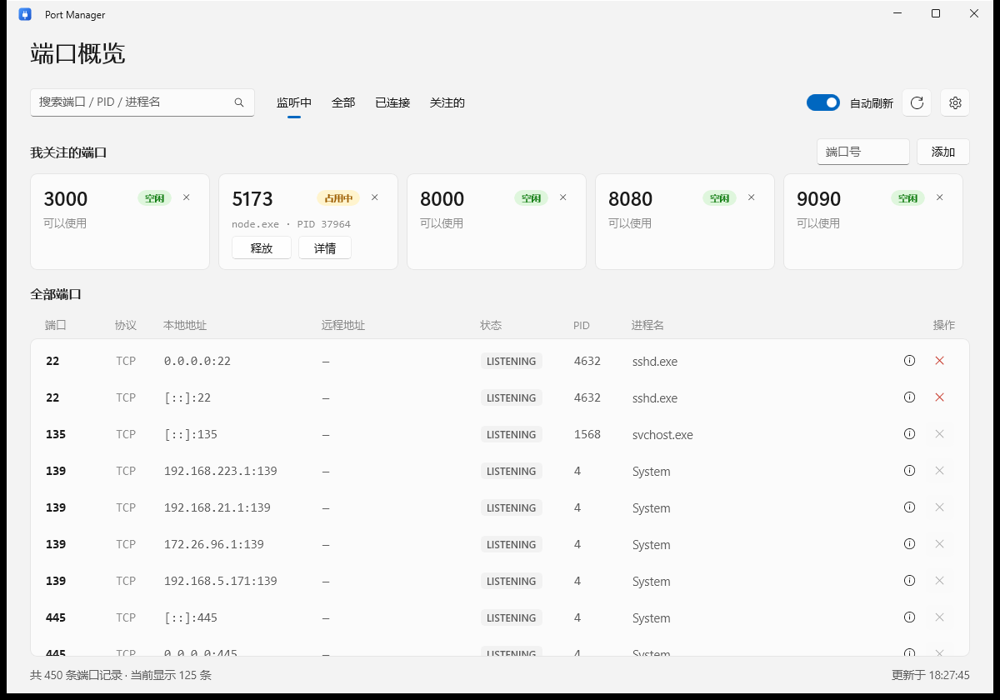
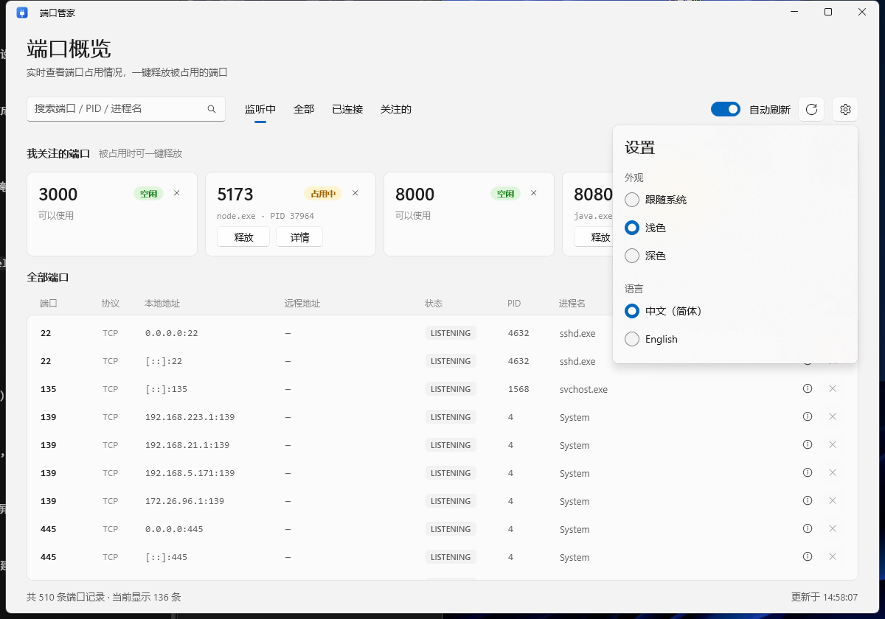
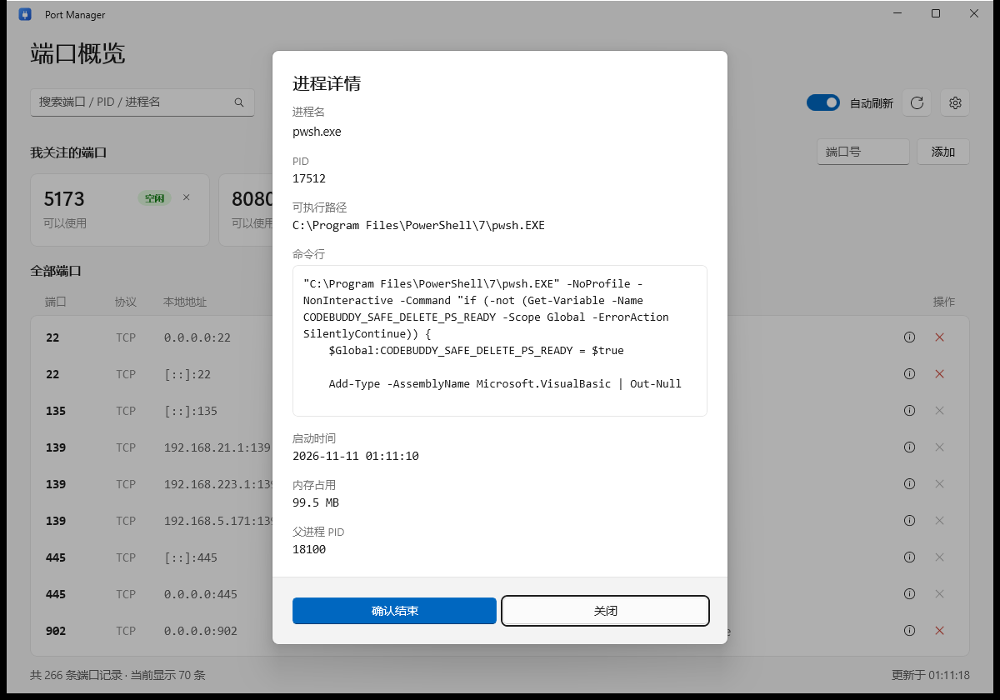

<div align="center">


# Port Manager

**See what is holding a port — and release it in one click.**

A native Windows port viewer built with WinUI 3. Fast, small, no installation required.

[](https://github.com/AIUUIIU/PortManager)
[](https://dotnet.microsoft.com/)
[](https://learn.microsoft.com/windows/apps/winui/winui3/)
[](LICENSE)

[English](#english) · [简体中文](#简体中文)

</div>



---

## English

### Why

You start your dev server and get `EADDRINUSE: address already in use :::8080`. Then you run `netstat -ano | findstr :8080`, copy the PID, run `taskkill /PID 1234 /F`, and hope you killed the right thing. Port Manager turns that into one glance and one click.

### Features

- **Reads the OS port table directly** — `GetExtendedTcpTable` / `GetExtendedUdpTable` via IP Helper API, no `netstat` text parsing. A full refresh takes a few milliseconds.
- **TCP + UDP, IPv4 + IPv6**, every connection state, deduplicated and sorted by port.
- **Search** by port, PID or process name; filter by Listening / Established / All / Watched.
- **Watched ports** — pin the ports you care about (8080, 3000, 5173, 8000 by default) and see *In use* or *Free* at a glance.
- **One-click release** — kills the whole process tree, with a built-in blocklist that protects system-critical processes.
- **Process details** — executable path, command line, start time, memory usage and parent PID.
- **Auto refresh** every 1.5 s, toggleable.
- **Light / dark / follow system**, **Chinese / English**, matching the Windows 11 look with Mica.
- **Portable** — a self-contained `PortManager.exe`, no Windows App SDK runtime to install.

### Screenshots

| Settings | Process details |
| --- | --- |
|  |  |

### Requirements

- Windows 10 version 1809 (build 17763) or later, Windows 11 recommended
- x64, x86 or ARM64
- Administrator rights are only needed to end processes owned by other users or by services

### Run

Download the latest release, extract the archive and double-click `PortManager.exe`. Nothing is written to the registry.

### Build from source

Requires the [.NET 10 SDK](https://dotnet.microsoft.com/download) and the Windows App SDK (restored automatically by NuGet).

```bash
git clone https://github.com/AIUUIIU/PortManager.git
cd PortManager
dotnet build -c Release
dotnet run -c Release
```

Publish a portable build:

```bash
dotnet publish -c Release -r win-x64 --self-contained true
```

The output lands in `bin\Release\net10.0-windows10.0.26100.0\win-x64\publish\`.

### How it works

1. `GetExtendedTcpTable` / `GetExtendedUdpTable` fill a buffer with `MIB_TCPROW_OWNER_PID`-style rows; each row carries the owning PID.
2. `Process.GetProcesses()` builds a PID → image-name map once per scan, so rows can show a friendly process name.
3. Releasing calls `Process.Kill(entireProcessTree: true)` after checking a blocklist of protected system processes (`lsass.exe`, `svchost.exe`, `csrss.exe`, …).
4. Command line and parent PID are queried on demand through `Win32_Process` CIM, so the scan itself stays fast.

### Limitations

- Windows only.
- Ending a process requires the matching privileges; protected or anti-cheat-guarded processes may refuse to exit.
- Ports held by kernel-mode drivers do not appear, because they have no user-mode owning process.

### Contributing

Issues and pull requests are welcome — please read [CONTRIBUTING.md](CONTRIBUTING.md) first. For security reports, see [SECURITY.md](SECURITY.md).

### License

[MIT](LICENSE) © 2026 AIUUIIU

---

## 简体中文

### 为什么做这个

启动开发服务器，报 `EADDRINUSE: address already in use :::8080`。于是 `netstat -ano | findstr :8080`，抄下 PID，再 `taskkill /PID 1234 /F`，还得担心杀错进程。Port Manager 把这一串操作变成"看一眼 + 点一下"。

### 功能

- **直接读取系统端口表** —— 通过 IP Helper API 调用 `GetExtendedTcpTable` / `GetExtendedUdpTable`，不解析 `netstat` 文本，整表刷新只需几毫秒。
- **TCP / UDP、IPv4 / IPv6** 全量覆盖，包含所有连接状态，自动去重并按端口排序。
- **搜索**端口、PID 或进程名；按「监听中 / 已连接 / 全部 / 关注的」筛选。
- **关注端口** —— 把常用的端口（默认 8080、3000、5173、8000）钉在顶部，直接显示「占用中」还是「空闲」。
- **一键释放** —— 结束整个进程树，内置系统关键进程黑名单，避免误杀。
- **进程详情** —— 可执行路径、命令行、启动时间、内存占用、父进程 PID。
- **自动刷新**（1.5 秒一次，可关闭）。
- **深色 / 浅色 / 跟随系统**，**中文 / English** 实时切换，Mica 材质与 Windows 11 原生观感一致。
- **免安装** —— 自包含单文件 `PortManager.exe`，不需要单独安装 Windows App SDK 运行时。

### 截图

| 设置 | 进程详情 |
| --- | --- |
|  |  |

### 系统要求

- Windows 10 1809（17763）及以上，推荐 Windows 11
- x64 / x86 / ARM64
- 仅当需要结束其他用户或系统服务占用的进程时，才需要管理员权限

### 运行

下载 Release 中的压缩包，解压后双击 `PortManager.exe` 即可，不写注册表、不留安装残留。

### 从源码构建

需要 [.NET 10 SDK](https://dotnet.microsoft.com/download)，Windows App SDK 由 NuGet 自动还原。

```bash
git clone https://github.com/AIUUIIU/PortManager.git
cd PortManager
dotnet build -c Release
dotnet run -c Release
```

发布免安装版本：

```bash
dotnet publish -c Release -r win-x64 --self-contained true
```

产物位于 `bin\Release\net10.0-windows10.0.26100.0\win-x64\publish\`。

### 项目结构

```
PortManagerWin.csproj      项目文件（非打包、自包含）
App.xaml(.cs)              应用入口、主题与语言初始化
MainWindow.xaml(.cs)       窗口、标题栏、Mica 背景
MainPage.xaml(.cs)         主界面：搜索、筛选、端口列表、关注卡片
Services/
  PortScanner.cs           P/Invoke 读取 TCP/UDP 端口表
  ProcessActions.cs        结束进程、读取进程详情
  Localization.cs          中英文文案与切换通知
  Diag.cs                  调试日志
ViewModels/
  MainViewModel.cs         列表、筛选、刷新、关注端口状态
Converters/                XAML 值转换器
tests/SelfTest/            控制台自测（扫描、去重、排序、保护名单）
tools/make_icon.py         生成多尺寸应用图标（纯标准库）
docs/screenshots/          README 截图
```

### 实现要点

1. `GetExtendedTcpTable` / `GetExtendedUdpTable` 把 `MIB_*ROW_OWNER_PID` 结构写入缓冲区，每行自带所属 PID。
2. 每次扫描用 `Process.GetProcesses()` 建立一次 PID → 进程名映射，界面才能显示友好名称。
3. 释放端口时调用 `Process.Kill(entireProcessTree: true)`，执行前先对照系统关键进程黑名单（`lsass.exe`、`svchost.exe`、`csrss.exe` 等）。
4. 命令行与父进程 PID 在打开详情时才通过 `Win32_Process` CIM 查询，保证扫描本身足够快。

### 已知限制

- 仅支持 Windows。
- 结束进程需要对应权限；受保护进程或带反作弊保护的程序可能拒绝退出。
- 由内核驱动直接占用的端口不会出现在列表中，因为它们没有用户态所属进程。

### 参与贡献

欢迎提交 Issue 和 Pull Request，请先阅读 [CONTRIBUTING.md](CONTRIBUTING.md)。安全问题请按 [SECURITY.md](SECURITY.md) 私下反馈。

### 许可证

[MIT](LICENSE) © 2026 AIUUIIU
